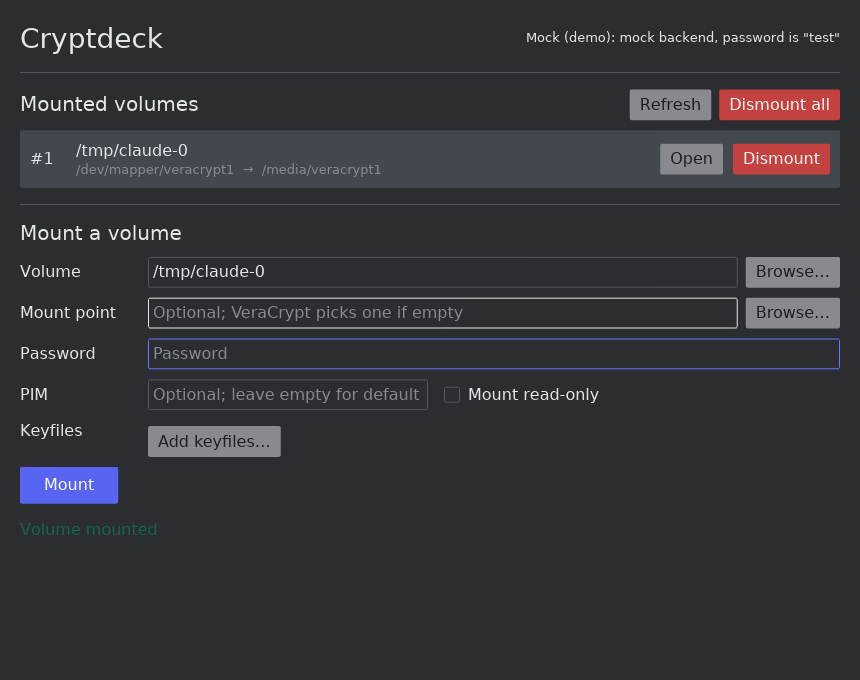

# Cryptdeck

A cross-platform desktop GUI for VeraCrypt volumes, written in Rust with
[iced](https://iced.rs).



> **Status: early prototype.** Linux works through the VeraCrypt CLI.
> macOS and Windows are planned. Don't trust it with data you can't afford
> to lose yet.

Cryptdeck is an independent project. It is not affiliated with or endorsed
by IDRIX or the VeraCrypt project.

## How it works

Cryptdeck doesn't implement any cryptography. It drives an existing, audited
tool as a separate process:

| Platform | Backend | Status |
| --- | --- | --- |
| Linux | `veracrypt --text` CLI, password passed on stdin | Working |
| Linux | `cryptsetup --type tcrypt --veracrypt` (no VeraCrypt install needed) | Planned |
| macOS | `veracrypt --text` CLI | Planned (should need little work) |
| Windows | VeraCrypt driver via `DeviceIoControl` | Planned |

Each backend implements the `Backend` trait in `cryptdeck-core`, and the GUI
only talks to that trait.

### Security notes

- The password is written to VeraCrypt's stdin (`--stdin`), so it never
  appears in the process list or in shell history.
- Inside Cryptdeck, the password is held in `secrecy`/`zeroize` types and
  wiped after a successful mount. iced's text input keeps its own copy while
  you're typing, and Cryptdeck can't wipe that copy.
- Mounting needs root. When Cryptdeck isn't running as root, it runs
  `veracrypt` through `pkexec`, which shows your desktop's polkit password
  dialog. A dedicated, narrowly scoped helper with its own polkit policy is
  on the roadmap.

## Building

You need Rust 1.85 or newer.

```bash
cargo build --release
```

On Linux you need VeraCrypt (the console or GUI build) and polkit (`pkexec`)
installed.

### Trying it without VeraCrypt

The mock backend keeps everything in memory. It accepts any existing file as
a volume, and the password is `test`:

```bash
CRYPTDECK_BACKEND=mock cargo run
```

### Environment variables

| Variable | Effect |
| --- | --- |
| `CRYPTDECK_BACKEND=mock` | Use the in-memory demo backend |
| `CRYPTDECK_VERACRYPT=/path/to/veracrypt` | Use a specific `veracrypt` binary |

## Layout

```
crates/
  cryptdeck-core/   Backend trait, VeraCrypt CLI backend, mock backend
  cryptdeck-gui/    iced desktop app (binary: cryptdeck)
```

## Roadmap

- [x] List, mount and dismount (Linux, VeraCrypt CLI)
- [x] PIM, keyfiles, read-only mounts
- [ ] polkit helper with a restricted policy instead of a raw `pkexec veracrypt`
- [ ] Mount ownership for non-root users (FAT, exFAT and NTFS `uid`/`gid` options)
- [ ] Hidden volume protection
- [ ] Favourite volumes and system tray
- [ ] `cryptsetup` backend
- [ ] Volume creation wizard
- [ ] macOS
- [ ] Windows

## License

Licensed under either of

- Apache License, Version 2.0 ([LICENSE-APACHE](LICENSE-APACHE))
- MIT license ([LICENSE-MIT](LICENSE-MIT))

at your option.

Cryptdeck runs VeraCrypt as a separate program and contains no VeraCrypt
code, so VeraCrypt's licenses (Apache 2.0 and the TrueCrypt License 3.0) do
not apply to it.
